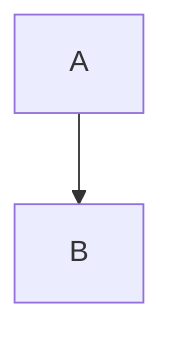

# 02 · Bad Note

## 1. TL;DR

- This bullet cites section §5, which must never be typed with the section sign.
- TODO fill this in. TBD later. Lorem ipsum dolor sit amet.

## The frame

Prose with a dead link to [another note](99-missing-note.md) and a figure that is not allowed here:


<div class="x">raw html that the builder does not allow</div>

```cpp {run}
int main() { return 0; }
```

```cpp
int a = 0;  // 100 columns ........................................................................X
int b = 0;  // 130 columns ......................................................................................................X
```



| c1 | c2 | c3 | c4 | c5 | c6 | c7 | c8 | c9 | c10 |
| --- | --- | --- | --- | --- | --- | --- | --- | --- | --- |
| 1 | 2 | 3 | 4 | 5 | 6 | 7 | 8 | 9 | 10 |

> **Gap fill:** this callout is far longer than the cap allows because the share of gap-fill words must stay
> under twenty percent of the prose and here it is the bulk of the whole note which is a seeded error that
> the linter has to flag, so we keep writing words and words and words until it is surely over the cap.
> More words follow so the share is certainly beyond the limit: alpha beta gamma delta epsilon zeta eta
> theta iota kappa lambda mu nu xi omicron pi rho sigma tau upsilon phi chi psi omega again and again.

> **Gap fill:** a second long callout to push the share over the limit: one two three four five six seven
> eight nine ten eleven twelve thirteen fourteen fifteen sixteen seventeen eighteen nineteen twenty more.

## Check yourself

1. **Only one question, but the range is 3 to 5.** Yes.

## Going Deeper

- one
- two
- three
- four
- five
- six
- seven
- eight
- nine
- ten
