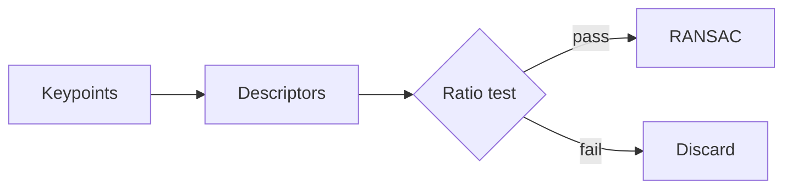

# 02 · Matching Basics

## What you need before this note

Gradients and blur. The derivations live in the companion [02a](02a-derivations.md).

## TL;DR

1. A **descriptor** is a list of numbers for one keypoint; matching compares lists.
2. Lowe's ratio test keeps a match only if $d_1 / d_2 < 0.75$.
3. A homography has 8 free numbers, so 4 point pairs suffice.

## 1. The ratio test

The distance between descriptors $a$ and $b$ is

$$ d(a,b) = \sqrt{\sum_{i=1}^{128} (a_i - b_i)^2} $$

A price of \$5 is a literal dollar, not maths.

```python
import numpy as np

def ratio_test(d1: float, d2: float, thr: float = 0.75) -> bool:
    return d1 / d2 < thr

print(ratio_test(0.4, 0.8))
```

```text
True
```


> **Maths:** with $n = 256$ pairs the descriptor is 32 bytes and Hamming distance is one XOR plus popcount.

> **Paper:** Lowe (2004), *Distinctive image features from scale-invariant keypoints*, IJCV.

> **Jargon:** **keypoint** = a pixel location chosen because it is easy to find again.

## 2. The pipeline as a diagram



### 2.1 RANSAC in one picture


<details><summary>Answer</summary>

The minimum sample for a line is 2 points, for a homography 4 pairs.

</details>

## 3. Comparison

| Method | Descriptor | Metric | Speed | Notes |
| --- | --- | --- | --- | --- |
| SIFT | 128 floats | L2 | slow | scale invariant |
| ORB | 256 bits | Hamming | fast | rotation aware |

Water is H<sub>2</sub>O and area is m<sup>2</sup>.

## Check yourself

1. How many point pairs fix a homography? **4** -- 8 unknowns, 2 equations per pair.

<details><summary>Answer</summary>

Four, because each pair gives two equations.

</details>

## Further Study

- Hartley and Zisserman, *Multiple View Geometry*.

## Sources

- [Lowe 2004](https://example.org/lowe-2004)
